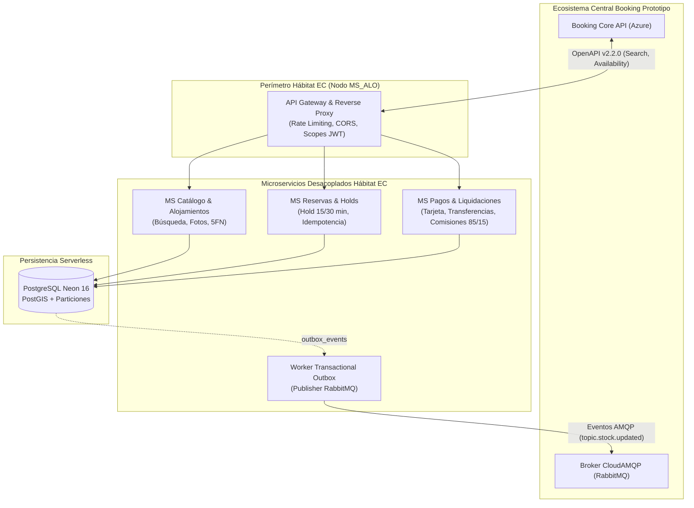

# Hábitat-EC 🌿🇪🇨
> **Plataforma Integral de Hospitalidad Sostenible, Ecoturismo y Gestión Hotelera en Ecuador**  
> *Proyecto Integrador de Sistemas — Nodo Microservicio Proveedor de Alojamientos (`MS_ALOJAMIENTOS`)*

[](Auditoria_Transicion_Reto2.md)
[-blueviolet?style=for-the-badge&logo=apachekafka&logoColor=white)](docs/Roadmap_Habitat_EC.md)

[](https://github.com/JArguelloC/habitat-ec/actions/workflows/ci-cd.yml)
[](https://nodejs.org/)
[](https://nestjs.com/)
[](https://react.dev/)
[](https://www.typescriptlang.org/)
[](https://neon.tech/)
[](https://tailwindcss.com/)
[](https://www.cloudamqp.com/)

---

> [!IMPORTANT]
> **ESTADO DE LA PLATAFORMA: TRANSICIÓN EXITOSA AL RETO 2**  
> El **Reto 1 ha sido completado y certificado al 100%**, logrando un flujo transaccional completo: búsqueda georreferenciada con PostGIS, retención pesimista de stock por 15 minutos (*Hold* NOWAIT), checkout seguro multimoneda con tarjeta 3D y transferencias locales (IVA 15%), liquidaciones automatizadas al anfitrión (85% neto) y confirmación PNR.  
> 
> Actualmente nos encontramos en la **Fase Activa del Reto 2**: desacoplamiento a microservicios independientes (`MS_CATALOG`, `MS_ORDERS`, `MS_PAYMENTS`), implementación del API Gateway perimetral e integración bidireccional mediante eventos con **Booking Prototipo** sobre **CloudAMQP (RabbitMQ)**.
> 
> 📄 Consulta el informe oficial de auditoría: [**`Auditoria_Transicion_Reto2.md`**](Auditoria_Transicion_Reto2.md) y el [**`Roadmap_Habitat_EC.md`**](docs/Roadmap_Habitat_EC.md).

---

## 1. Tecnologías de Vanguardia

| Capa | Tecnologías Clave | Propósito y Capacidades |
| :--- | :--- | :--- |
| **Backend Core** | **NestJS 12**, Node.js 22 LTS, TypeScript 5.9 | Framework modular de alta concurrencia, inyección de dependencias, filtros globales con diagnóstico PostgreSQL, ValidationPipes y Swagger OpenAPI 3.0. |
| **Base de Datos** | **Neon PostgreSQL 16**, PostGIS, `btree_gist` | Base de datos relacional serverless con modelo estricto en **Quinta Forma Normal (5FN)**, indexación espacial para eco-lodges y exclusión de fechas anti-overbooking. |
| **Frontend SPA** | **React 19**, Vite 8, Tailwind CSS, Lucide React | Interfaz de alto rendimiento con paleta "Oro Campestre y Lino", datepickers interactivos validados, tarjeta de crédito 3D interactiva y temporizador persistente en `localStorage`. |
| **Mensajería B2B** | **CloudAMQP (RabbitMQ)**, Transactional Outbox | Arquitectura orientada a eventos (EDA) con entrega garantizada *At-Least-Once* de eventos de dominio hacia sistemas mayoristas externos. |
| **Seguridad & Auth** | JWT, Google OAuth 2.0, Bcrypt, RBAC | Autenticación híbrida robusta con control de acceso basado en roles (`SUPERADMIN`, `ADMIN`, `CLIENTE`). |
| **DevOps & Cloud** | Azure Web App (Linux), Vercel, GitHub Actions | Despliegue continuo automatizado con pipelines de validación estática (ESLint 0 errores), compilación y delivery sin fricción. |

---

## 2. Arquitectura del Ecosistema

### 2.1. Arquitectura Actual (Reto 1 Consolidado)

```
                              ┌─────────────────────────────────────────┐
                              │           CLIENTES & VIAJEROS           │
                              │    Frontend SPA (React 19 + Tailwind)   │
                              │           [habitat-ec.vercel.app]       │
                              └────────────────────┬────────────────────┘
                                                   │ HTTPS / REST API
                                                   ▼
                              ┌─────────────────────────────────────────┐
                              │      HÁBITAT-EC BACKEND (NESTJS 12)     │
                              │    [Azure App Service Linux Container]  │
                              │                                         │
                              │  - Auth & Google OAuth2 Guard (RBAC)    │
                              │  - Catálogos Geográficos (PostGIS)      │
                              │  - Alojamientos, Habitaciones & Reglas  │
                              │  - Órdenes & Holds Pesimistas (15 min)  │
                              │  - Pasarelas de Pago (Tarjeta / Transf) │
                              │  - Transactional Outbox Event Table     │
                              └────────────────────┬────────────────────┘
                                                   │
                                 ACID Transactions │ SSL (Neon CA)
                                                   ▼
                              ┌─────────────────────────────────────────┐
                              │    NEON SERVERLESS POSTGRESQL 16 DB     │
                              │  - 5FN Lossless Views (canal_politicas) │
                              │  - PostGIS Extension (ST_DWithin)       │
                              │  - Stored Procedures (NOWAIT Hold)      │
                              │  - Triggers Bidireccionales DML         │
                              │  - outbox_events & auditoria_forense    │
                              └─────────────────────────────────────────┘
```

---

### 2.2. Arquitectura de Transición (Fase Activa: Reto 2)



---

## 3. Módulos de Dominio y Flujos Transaccionales

1. **`auth` & `usuarios`:** Autenticación JWT y Google OAuth 2.0 con RBAC estricto (`SUPERADMIN`, `ADMIN`, `CLIENTE`).
2. **`catalogos`:** Catálogos geográficos PostGIS de las 24 provincias del Ecuador y matriz proyectiva en **Quinta Forma Normal (5FN)** (`canal_politicas`).
3. **`alojamientos`:** Catálogo público y panel de anfitrión para administración de cabañas, cuartos con inventario numérico y reglas de estancia.
4. **`ordenes`:** Motor de reservas con *Hold* pesimista de 15 minutos (`sp_generar_order_preview`), descuento atómico de stock y confirmación idempotente (`sp_crear_orden_idempotente`).
5. **`finanzas-resenas`:** Cobro con tarjeta (Payphone/Stripe), validación de transferencias bancarias locales (IVA 15%), libro mayor con liquidación automática al anfitrión y módulo de reseñas.
6. **`integracion-auditoria`:** Bitácora inmutable en `auditoria_forense` y eventos de dominio en `outbox_events` listos para ser despachados hacia RabbitMQ.

---

## 4. Instalación y Ejecución Local

### Prerrequisitos
- **Node.js:** v22 LTS o superior
- **Gestor de paquetes:** `npm` v10+
- **PostgreSQL:** Instancia de PostgreSQL 16 con PostGIS habilitado (recomendado: Neon Serverless)

### Backend (NestJS 12)
```powershell
cd backend
npm install
npm run build
npm run start:dev
```

### Frontend SPA (React 19)
```powershell
cd frontend
npm install
npm run build
npm run dev
```

### Comprobación de Calidad de Código
```powershell
npm --prefix frontend run lint   # 0 errores ESLint
npm --prefix backend run build    # 0 errores NestJS / TypeScript
```

---

## 5. Documentación y Recursos Clave

* 📊 [**Auditoría de Transición al Reto 2 (`Auditoria_Transicion_Reto2.md`)**](Auditoria_Transicion_Reto2.md)
* 🗺️ [**Roadmap Oficial de Hábitat EC (`docs/Roadmap_Habitat_EC.md`)**](docs/Roadmap_Habitat_EC.md)
* 📐 [**Contrato API OpenAPI 3.0 (`contracts/habitat-ec-v1.yaml`)**](contracts/habitat-ec-v1.yaml)
* 🏛️ [**Auditoría de Arquitectura de Datos (`docs/auditoria_arquitectura_backend_mvp.md`)**](docs/auditoria_arquitectura_backend_mvp.md)

---

## 6. Licencia
Proyecto desarrollado en el marco del **Proyecto Integrador de Sistemas (Sexto Semestre)** — Pontificia Universidad Católica del Ecuador.
