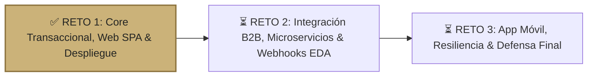

# 🌿 Roadmap Oficial del Proyecto: Hábitat EC

> **Proyecto Integrador de Sistemas:** Plataforma Transaccional de Hospedaje Sostenible, Eco-Lodges y Hoteles en Ecuador.  
> **Arquitectura:** Full-Stack desacoplada (`NestJS 12 + PostgreSQL Neon + PostGIS + 5FN` en Backend y `React 19 + TypeScript + Tailwind CSS` en Frontend SPA).  
> **Fecha de Actualización:** 02 de Noviembre de 2026.

---

## 📊 Estado Ejecutivo de Cumplimiento

| Componente del Sistema | Estado Actual | Cumplimiento del Reto 1 |
| :--- | :---: | :---: |
| **Base de Datos Relacional (Neon PostgreSQL 16)** | Concluida | **100%** (5FN, PostGIS, GiST, Auditoría, Outbox) |
| **Backend API REST & Documentación OpenAPI (NestJS)** | Concluida | **100%** (48 Endpoints certificados, Swagger, RBAC) |
| **Control Numérico de Stock (Hoteles vs. Eco-Lodges)** | Concluida | **100%** (Concurrencia ACID, Hold 15 min, Rollback Saga) |
| **Autenticación Unificada (Google OAuth 2.0 & JWT)** | Concluida | **100%** (Auto-registro de CLIENTES, perfiles, RBAC multinivel) |
| **Frontend Web SPA (React 19 + Tailwind CSS)** | Concluida | **100%** (Paleta Oro Campestre & Lino, 10 Heurísticas Nielsen) |
| **Pasarelas de Pago Híbridas (Payphone Ecuador / Stripe)** | Concluida | **100%** (Adaptador de adquirente local e internacional) |
| **Contenerización y DevOps (Docker + GitHub Actions)** | Concluida | **100%** (Multi-stage builds, Nginx SPA proxy, CI/CD) |

---

## 🎯 Reto 1: Estado Detallado de Implementación (100% COMPLETADO)

### 1. Base de Datos & Reglas de Negocio en Quinta Forma Normal (5FN)
- [x] **Modelo Relacional en 5FN:** Descomposición sin pérdida (*lossless-join*) de relaciones ternarias entre alojamientos, canales de integración y políticas de cancelación (`vw_contratos_5fn_validos`).
- [x] **Georreferenciación PostGIS:** Soporte de coordenadas espaciales nativas en Ecuador para búsquedas por proximidad y destino.
- [x] **Protección Anti-Sobreventa GiST:** Índices `btree_gist` para bloqueos temporales (*Hold* de 15:00 minutos pesimista con liberación automática).
- [x] **Control de Stock Concurrente:** Soporte para alojamientos de reserva completa (cabañas) y establecimientos con control de inventario numérico por tipo de habitación (hoteles y hostales).
- [x] **Auditoría Forense Legal & Outbox:** Registro de mutaciones por triggers DML (`auditoria_forense_legal`) y almacenamiento transaccional de eventos en `outbox_events`.

### 2. Backend API RESTful (NestJS 12 + TypeORM)
- [x] **Módulo de Autenticación & Google OAuth 2.0:** Endpoint público `POST /api/v1/auth/google` con verificación de ID Token mediante `google-auth-library` y aprovisionamiento transaccional de usuarios rol `CLIENTE`.
- [x] **Módulo de Usuarios & Perfil:** Endpoints `GET` y `PATCH /api/v1/usuarios/perfil` para autogestión de viajeros y anfitriones.
- [x] **Módulo de Alojamientos & Catálogos:** Búsqueda flexible multicriterio (`POST /api/v1/alojamientos/search`), detalle con relaciones (`GET /api/v1/alojamientos/:id`) y gestión de catálogo maestro.
- [x] **Módulo de Órdenes & Holds:** Generación de previews con Hold (`POST /api/v1/ordenes/preview`), checkout idempotente (`POST /api/v1/ordenes/create`) y Saga compensatoria de cancelación (`POST /api/v1/ordenes/:id/cancelar`).
- [x] **Módulo Financiero y Pasarela Híbrida:** 
  - Adaptador `PaymentGatewayAdapterService` con integración para **Payphone Ecuador** (`PAYPHONE_EC`) y **Stripe PaymentIntents** (`STRIPE`), con fallback a Sandbox Certificado.
  - Generación de liquidaciones automáticas al anfitrión (85% neto) y recálculo de calificaciones por trigger.
- [x] **Módulo de Integración EDA & Worker Outbox:** Despacho manual/programado de eventos pendientes en Outbox hacia Webhooks con firma `HMAC-SHA256` (`POST /api/v1/auditoria/outbox/despachar`).
- [x] **Certificación de Endpoints:** 48 pruebas de endpoints certificadas con 100% PASS y base de datos purgada.

### 3. Frontend Web SPA Unificado (React 19 + TypeScript + Tailwind CSS)
- [x] **Sistema de Diseño Oficial (Paleta "Oro Campestre & Lino"):**
  - Textos: `#242523` • Fondo: `#F9F8F5` • Primario: `#CBB279` • Secundario (Sello Eco): `#6E7A6E` • Acento: `#8C733E` • Superficie: `#FFFFFF` • Borde: `#E7E4DC`.
  - Aplicación de las 10 Heurísticas de Usabilidad de Jakob Nielsen.
- [x] **Navegación Dinámica RBAC:** Barra de navegación unificada con acceso condicional por roles (`CLIENTE`, `ADMIN`, `SUPERADMIN`).
- [x] **Vistas Implementadas:**
  1. `/login` y `/registro`: Formulario lino/oro con botón oficial `<GoogleLogin />` integrado a Google OAuth 2.0.
  2. `/` (Home Marketplace): Buscador píldora (destino, fechas y cuartos), filtros por tipología y cuadrícula de tarjetas con badges y precios.
  3. `/alojamientos/:id`: Mosaico de 5 fotos, sellos verdes salvia de sostenibilidad, reglas, selector de habitaciones con stock y tarjeta lateral sticky de cotización.
  4. `/checkout`: Barra de 3 pasos, temporizador en vivo de 15:00 minutos, selector de adquirente (Payphone / Stripe), idempotencia y generación de Voucher con código PNR (`HAB-EC-...`).
  5. `/mis-reservas`: Listado de reservas, modal de cancelación con Saga compensatoria y evaluación de estancia multicriterio por categorías.
  6. `/perfil`: Vista de autogestión de datos personales y credenciales.
  7. `/admin`: Panel estilo Lodgify con KPIs, tabla de liquidaciones (85% neto) y Wizard guiado en 4 pasos para publicar propiedades con stock numérico y contratos 5FN.
  8. `/superadmin`: Consola maestra con creación de cuentas ADMIN, CRUD de catálogos/matriz 5FN, visualizador forense y disparador del Worker Outbox HMAC.

### 4. DevOps, Contenerización y CI/CD
- [x] `backend/Dockerfile` multi-stage en `node:22-alpine` con usuario sin privilegios.
- [x] `frontend/Dockerfile` multi-stage con compilación de Vite y servidor `nginx:1.27-alpine` con proxy reverso `/api/v1` y fallback SPA.
- [x] `docker-compose.yml` para orquestación local completa de ambos servicios.
- [x] `.env.example` en backend y frontend para despliegue sin exposición de secretos.
- [x] `.github/workflows/ci-cd.yml` automatizando linting, chequeo de tipos y compilación en GitHub Actions.

---

## 🚀 Fase 2: Reto 2 - Integración B2B, Microservicios y EDA (Semanas 7 a 11)

- [ ] **Desacoplamiento Gradual de Servicios:** Separación conceptual entre Servicio de Identidad/Usuarios, Servicio de Catálogos/Inventario y Servicio de Pagos/Liquidaciones.
- [ ] **API Gateway & Perímetro:** Ruteo unificado y gestión centralizada de CORS y rate limiting.
- [ ] **Worker Asíncrono Continuo:** Procesamiento en segundo plano de la cola `outbox_events` mediante cron o worker runner.
- [ ] **Interoperabilidad B2B:** Pruebas de integración de Webhooks con plataformas externas (Booking prototipo) y validación de firmas HMAC.

---

## 📱 Fase 3: Reto 3 - Experiencia Móvil y Resiliencia Final (Semanas 12 a 16)

- [ ] **Aplicación Móvil para Huéspedes:** Desarrollo de la app cliente en Flutter / React Native para reservas sobre la marcha.
- [ ] **Modo Offline & Caché:** Soporte para consulta de vouchers PNR sin conexión en zonas remotas de Ecuador.
- [ ] **Defensa Final:** Pruebas de carga, verificación de tolerancia a fallos y sustentación técnica del ecosistema.
