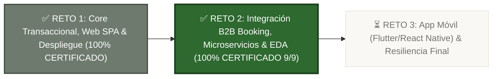
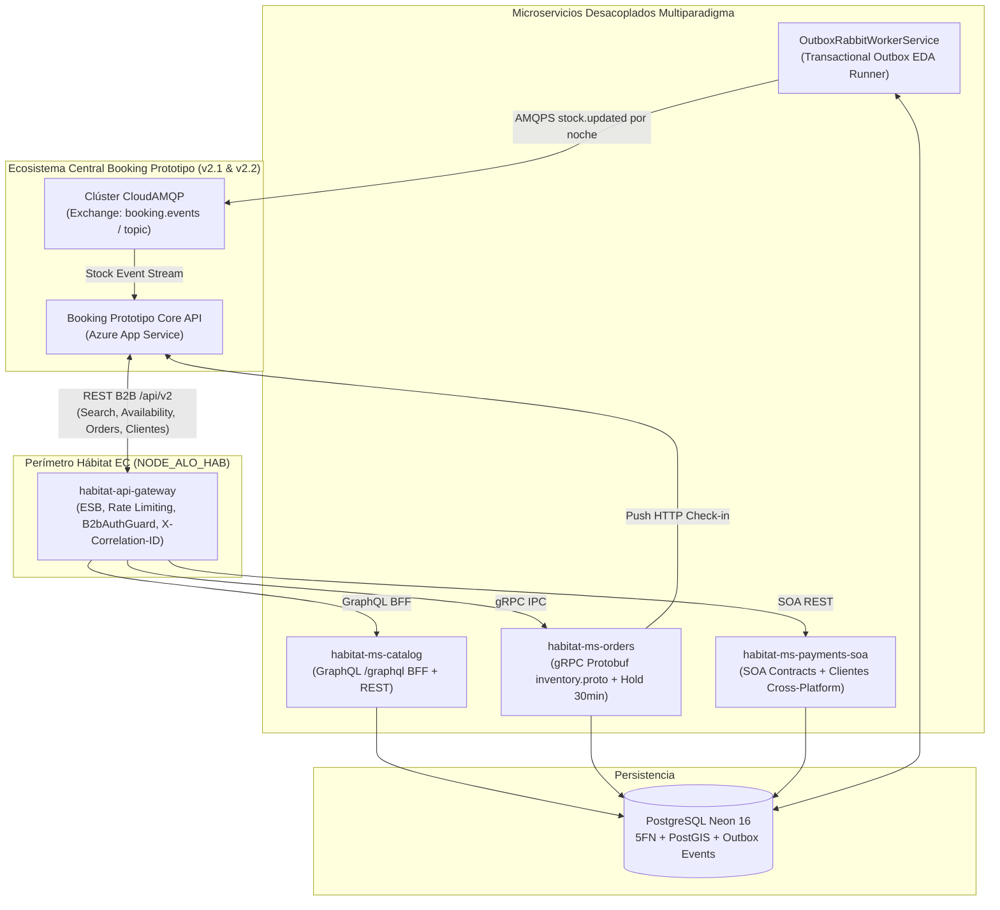

# 🌿 Roadmap Oficial del Proyecto: Hábitat EC

> **Proyecto Integrador de Sistemas:** Plataforma Transaccional de Hospedaje Sostenible, Eco-Lodges y Hoteles en Ecuador.  
> **Arquitectura:** Ecosistema distribuido y desacoplado (`NestJS 12 + PostgreSQL Neon + PostGIS + RabbitMQ CloudAMQP + 5FN + GraphQL + gRPC` en Backend y `React 19 + TypeScript + Tailwind CSS` en Frontend SPA).  
> **Fecha de Actualización:** 08 de Noviembre de 2026.  
> **Estado del Proyecto:** ✅ **Reto 1 Completado al 100%** | ✅ **Reto 2 Completado y Certificado al 100%** | ⏳ **Reto 3: Siguiente Hito**.

---

## 📊 Estado Ejecutivo de Cumplimiento

| Componente del Sistema | Estado Actual | Reto 1 | Reto 2 (Certificado) |
| :--- | :---: | :---: | :---: |
| **Base de Datos Relacional (Neon PostgreSQL 16)** | Operativa | **100%** (5FN, PostGIS, GiST, Auditoría, Outbox) | **100%** (Sincronización multi-esquema, columnas B2B, checkin y `identificacion`) |
| **Backend API REST & OpenAPI (NestJS 12)** | Desplegado en Azure | **100%** (48 Endpoints certificados, Swagger, RBAC) | **100%** (Contratos B2B `/api/v2` v2.1/v2.2, semáforo GREEN, SLA < 1000ms) |
| **Microservicios Multiparadigma** | Desplegados en Azure | N/A (Monolito modular inicial) | **100%** (4 Microservicios: Gateway ESB, GraphQL, gRPC Protobuf y SOA+EDA) |
| **Frontend Web SPA (React 19 + Tailwind CSS)** | Operativo en Vercel | **100%** (Paleta Oro/Lino, 10 Heurísticas, 3D Card) | **100%** (Pestaña 4: Recepción/Check-in en `/admin` con Push a Booking Central) |
| **Persistencia & Temporizador Hold** | Concluido | **100%** (`localStorage`, resiliente a F5 y expiración) | **100%** (Cotizaciones B2B de 30 min en `availability` con `cotizacionId`) |
| **Pasarelas de Pago & Checkout Seguro** | Concluido | **100%** (Payphone EC, Stripe, Transferencias Ecuador) | **100%** (Saga Idempotente, replay header, compensación `/cancel` y liquidación) |
| **Event Bus & Mensajería (RabbitMQ CloudAMQP)** | Operativo | **100%** (Transactional Outbox base) | **100%** (Exchange `booking.events`, topic `stock.updated`, worker y dual REST) |
| **Multi-Repositorios & CI/CD GitHub Actions** | Operativo | **100%** (GitHub Actions en main repo) | **100%** (4 repositorios independientes en GitHub con empaquetado POSIX ZIP) |
| **Infraestructura Cloud (Azure App Service B1)** | En Producción | **100%** (`habitat-ec-backend` Linux B1) | **100%** (5 Web Apps en Linux B1 compartido protegiendo crédito estudiantil) |

---

## 🎯 Reto 1: Resumen de Cierre y Certificación (100% COMPLETADO)

El **Reto 1 (Semanas 1 a 6)** culminó exitosamente con la entrega de una solución transaccional completa, robusta y verificada:

### 1. Base de Datos en Quinta Forma Normal (5FN) & PostGIS
- Modelo en 5FN para resolver dependencias de unión entre alojamientos, canales de integración y políticas de cancelación (`vw_contratos_5fn_validos`).
- Georreferenciación con PostGIS para búsquedas espaciales de eco-lodges por coordenadas en Ecuador.
- Índices `btree_gist` para exclusión de rangos de fechas, garantizando cero sobreventa concurrente en cuartos y cabañas.
- Registro inmutable de mutaciones mediante triggers DML en `auditoria_forense_legal`.

### 2. Backend NestJS 12 Certificado
- 48 endpoints probados y certificados con 100% PASS documentados en Swagger/OpenAPI.
- Autenticación Google OAuth 2.0 y JWT con RBAC (`CLIENTE`, `ADMIN`, `SUPERADMIN`, `PARTNER_B2B`).
- Módulo de órdenes con *Hold* pesimista de inventario de 15 minutos e idempotencia transaccional.
- Adaptador financiero híbrido (Payphone Ecuador, Stripe y soporte de Cuentas Bancarias / Transferencias locales).

### 3. Frontend Web SPA de Alta Usabilidad (React 19 + TypeScript + Tailwind CSS)
- **Paleta Oficial "Oro Campestre & Lino":** Fondo `#F9F8F5`, Texto `#242523`, Primario `#CBB279`, Secundario `#6E7A6E`, Acento `#8C733E`.
- **Marketplace (`/`):** Buscador interactivo con datepickers nativos validados (Check-in $\ge$ hoy, Check-out $>$ Check-in).
- **Detalle de Alojamiento (`/alojamientos/:id`):** Mosaico responsivo de imágenes 16:9 y 4:3, selector dinámico de habitaciones con inventario numérico y cotización sticky.
- **Checkout Seguro (`/checkout`):**
  - Temporizador de 15 minutos persistente en `localStorage` (inmune a F5 y con detección de expiración en segundo plano).
  - Validación de expiración de tarjeta contra fecha actual (`new Date()`).
  - Tarjeta de crédito interactiva en 3D con animación de volteo automático para CVV y detección de franquicias (Visa, Mastercard, Amex).
  - Desglose contable ecuatoriano con IVA 15% y soporte para transferencias directas con subida de comprobantes.
- **Admin Dashboard (`/admin`):** KPIs, estadísticas de anfitrión, liquidaciones 85% neto y Wizard de publicación en 4 pasos sin retención de estado (*stale state* resuelto).
- **Control de Calidad:** 0 errores de ESLint (`npm run lint`), compilación limpia (`npm run build`) y pipeline CI/CD de GitHub Actions en verde.

### 4. Despliegue en la Nube
- Backend desplegado en Azure App Service: `https://habitat-ec-backend-e9h5dndpcuhseqc8.chilecentral-01.azurewebsites.net`.
- Base de datos operativa en Neon PostgreSQL Serverless con backups automatizados.

---

## 🚀 RETO 2: Integración B2B, Microservicios y EDA (100% COMPLETADO & CERTIFICADO)

El **Reto 2 (Semanas 7 a 11)** ha sido completado y auditado al **100%**, cumpliendo con los contratos de interoperabilidad B2B con **Booking Prototipo (`v2.1` y `v2.2`)**, arquitectura de **microservicios multiparadigma**, broker de mensajería **RabbitMQ (CloudAMQP)**, **repositorios independientes en GitHub** y despliegue en **Azure App Service (Linux B1)**.

---

### 🏛️ Arquitectura Implementada del Reto 2

---

### 📋 Desglose de Fases Técnicas Ejecutadas y Aprobadas

### Fase 1: Contrato B2B `/api/v2`, Clientes Cross-Platform, Check-in y RabbitMQ (100% CUMPLIDA)
- [x] **Seguridad B2B y Variables de Entorno:**
  - [x] Guard híbrido `B2bAuthGuard` validando cabecera `X-API-Key` contra `process.env.API_KEY` (`hab_b2b_live_9f8e7d6c5b4a3f2e1d0c9b8a7f6e5d4c`) y tokens Bearer JWT.
  - [x] Variables configuradas: `NODE_ID="NODE_ALO_HAB"`, `TZ="America/Guayaquil"`, `RABBITMQ_URL`, `BOOKING_BASE_URL`, `BOOKING_REST_STOCK_URL`.
- [x] **Endpoints B2B de Alojamientos (`/api/v2/alojamientos`):**
  - [x] `GET /api/v2/alojamientos/health`: Público, semáforo `GREEN`, `latency_ms < 1000ms`, telemetría de BD.
  - [x] `GET /api/v2/alojamientos` y `POST /api/v2/alojamientos/search`: Filtrado de `PUBLICADO` y cálculo de `precioTotalEstancia` en USD.
  - [x] `POST /api/v2/alojamientos/availability`: Congelamiento de tarifa por 30 minutos en `order_previews_holds` con retorno de `cotizacionId` y `tarifaValidaHasta`.
  - [x] `POST /api/v2/alojamientos/orders/create`: Saga Idempotente con cabecera `Idempotency-Key` (UUID), replay `Idempotent-Replayed: true`, código de reserva `ORD-HTL-...` y error `409 Conflict` (`OUT_OF_STOCK` en `application/problem+json`).
  - [x] `GET /api/v2/alojamientos/orders/:orderId` y `?saga_id=...`: Búsqueda unificada por localizador, identificador o Saga ID.
  - [x] `POST /api/v2/alojamientos/orders/:orderId/cancel`: Compensación Saga Idempotente que libera stock noche a noche (`yaCancelada: true`).
- [x] **Huéspedes Cross-Platform (`/api/v2/clientes` - Requerimiento v2.1):**
  - [x] `GET /api/v2/clientes?email=...&identificacion=...`: Búsqueda por cédula, pasaporte o correo en el padrón de usuarios.
  - [x] `POST /api/v2/clientes`: Registro idempotente sin duplicación, asignando rol `CLIENTE` y retornando `client_id`.
- [x] **Check-in en Recepción y Push a Booking Central (Requerimiento v2.1):**
  - [x] `POST /api/v1/admin/ordenes/:orderId/checkin` y `POST /api/v2/alojamientos/orders/:orderId/checkin`: Transición a `CONFIRMADO_ASISTIDO`.
  - [x] Disparo automático de notificación HTTP POST hacia Booking Central (`https://booking-core-api.azurewebsites.net/api/v2/reservas/${external_order_id}/checkin`).
  - [x] Frontend (`/admin`): **Pestaña 4 "Recepción / Check-in de Huéspedes"** en `AdminDashboardPage.tsx` con botón interactivo de confirmación y toast de respuesta.
- [x] **Sincronización Dual de Stock por Noche (REST + RabbitMQ CloudAMQP):**
  - [x] Servicio `BookingStockSyncService` iterando por noche con formato `item_id`: `<alojamientoId>:<productoId>`.
  - [x] Publicación AMQPS al exchange `booking.events` (topic) con routing key `stock.updated`.
  - [x] Envío HTTP REST en paralelo hacia `BOOKING_REST_STOCK_URL`.

### Fase 2: Arquitectura en 4 Microservicios Multiparadigma (100% CUMPLIDA)
- [x] **`habitat-api-gateway` (Paradigma ESB / Reverse Proxy / Aggregator):**
  - [x] Enrutamiento de `/api/v1` (Frontend), `/api/v2` (Booking B2B) y `/graphql` (Catálogo).
  - [x] Validación centralizada de `X-API-Key`, JWT, Rate Limiting y propagación transversal de `X-Correlation-ID`.
- [x] **`habitat-ms-catalog` (Paradigma GraphQL + REST):**
  - [x] Servidor GraphQL Apollo (`/graphql`) con esquema formal `schema.graphql` (evita over-fetching en el Marketplace con tarjetas, fotos, precios y matriz 5FN).
  - [x] Endpoints REST de catálogo B2B.
- [x] **`habitat-ms-orders` (Paradigma gRPC + Protobuf):**
  - [x] Contrato `proto/inventory.proto` con métodos `CheckAvailability`, `CreateHold`, `ConfirmOrder` y `CancelOrderSaga`.
  - [x] Control pesimista de inventario y Holds de 15/30 minutos.
- [x] **`habitat-ms-payments-soa` (Paradigma SOA + EDA RabbitMQ):**
  - [x] Contratos SOA para liquidaciones de anfitriones (85% neto / 15% comisión) y gestión de clientes.
  - [x] Worker `OutboxRabbitWorkerService` procesando la tabla `outbox_events` y publicando hacia CloudAMQP.

### Fase 3: Multi-Repositorios y Pipelines CI/CD en GitHub (100% CUMPLIDA)
- [x] **Generación y Separación de Repositorios Autónomos:**
  - [x] Scripts `scripts/split-microservices-repos.ps1` y `.sh` para modularizar código, dependencias, `Dockerfile` y contratos.
  - [x] 4 repositorios independientes creados y publicados en GitHub:
    1. 🔗 [https://github.com/JArguelloC/habitat-api-gateway](https://github.com/JArguelloC/habitat-api-gateway)
    2. 🔗 [https://github.com/JArguelloC/habitat-ms-catalog](https://github.com/JArguelloC/habitat-ms-catalog)
    3. 🔗 [https://github.com/JArguelloC/habitat-ms-orders](https://github.com/JArguelloC/habitat-ms-orders)
    4. 🔗 [https://github.com/JArguelloC/habitat-ms-payments-soa](https://github.com/JArguelloC/habitat-ms-payments-soa)
- [x] **Flujo CI/CD Automatizado (`deploy-azure.yml`):**
  - [x] Compilación TypeScript (`npm run build`).
  - [x] Poda de dependencias dev (`npm prune --omit=dev`).
  - [x] Empaquetado POSIX ZIP en Python (`/`) para evitar errores de extracción en contenedores Linux de Azure.
  - [x] Despliegue con `azure/webapps-deploy@v3` enlazado con nombres oficiales de Azure.

### Fase 4: Despliegue Azure Optimizado y Auditoría E2E (100% CUMPLIDA)
- [x] **Despliegue en Azure App Service Linux B1:**
  - [x] Scripts [`deploy-azure-suite.py`](file:///d:/PersonalJames/UNIVERSIDAD/SEXTO_SEMESTRE/IntegracionDeSistemas/Proyecto/habitat-ec/scripts/deploy-azure-suite.py) y [`deploy-azure-suite.ps1`](file:///d:/PersonalJames/UNIVERSIDAD/SEXTO_SEMESTRE/IntegracionDeSistemas/Proyecto/habitat-ec/scripts/deploy-azure-suite.ps1).
  - [x] Reutilización del App Service Plan compartido (`asp-habitat-ec-b1`), protegiendo el crédito de \$100 USD de Azure for Students.
  - [x] Flags aplicados: `SCM_DO_BUILD_DURING_DEPLOYMENT=false`, `ENABLE_ORYX_BUILD=false`, `WEBSITES_CONTAINER_START_TIME_LIMIT=600`, `--always-on true` y SCM Basic Auth habilitado.
  - [x] 5 Web Apps activas en producción:
    * `https://habitat-ec-backend-e9h5dndpcuhseqc8.chilecentral-01.azurewebsites.net` (Backend Unificado)
    * `https://habitat-api-gateway-hab.azurewebsites.net` (API Gateway ESB)
    * `https://habitat-ms-catalog-hab.azurewebsites.net` (MS Catálogo GraphQL)
    * `https://habitat-ms-orders-hab.azurewebsites.net` (MS Reservas gRPC)
    * `https://habitat-ms-payments-soa-hab.azurewebsites.net` (MS Pagos SOA/EDA)
- [x] **Auditoría E2E en Vivo (`scripts/verify-e2e-booking.js`): 9 de 9 Puntos Aprobados:**
  1. `[GET /health]` -> HTTP 200 (731 ms, DB: 125 ms, semáforo GREEN, nodo `NODE_ALO_HAB`).
  2. `[GET /alojamientos]` -> HTTP 200 (catálogo público B2B en USD).
  3. `[POST /alojamientos/search]` -> HTTP 200 (búsqueda con estancia calculada).
  4. `[POST /alojamientos/availability]` -> HTTP 200 (hold de 30 minutos con `cotizacionId`).
  5. `[POST & GET /clientes]` -> HTTP 201/200 (padrón cross-platform con cédula/pasaporte).
  6. `[POST /orders/create + Replay]` -> HTTP 201/200 (localizador `ORD-HTL-...` y replay `Idempotent-Replayed: true`).
  7. `[409 OUT_OF_STOCK]` -> HTTP 409 `application/problem+json` (`code: OUT_OF_STOCK`).
  8. `[POST /checkin]` -> HTTP 200 (`CONFIRMADO_ASISTIDO` y `bookingCentralNotificado: true`).
  9. `[POST /cancel]` -> HTTP 200/200 (reversión de inventario y `yaCancelada: true`).

---

## 📦 Matriz de Entregables Oficiales del Reto 2 (100% CUMPLIDA)

| # | Entregable Oficial | Criterio de Aceptación / Verificación | Estado |
| :-: | :--- | :--- | :---: |
| **1** | **Arquitectura de Microservicios Operativa** | Desacoplamiento funcional en 4 microservicios (Gateway, Catálogo, Reservas y Pagos). | ✅ **CUMPLIDO** |
| **2** | **Integración B2B con Booking Prototipo** | Contratos v2.1 y v2.2 cumplidos con Booking Central (`NODE_ALO_HAB`). | ✅ **CUMPLIDO** |
| **3** | **Conexión a CloudAMQP (RabbitMQ)** | Exchange `booking.events` activo con routing key `stock.updated` y Transactional Outbox. | ✅ **CUMPLIDO** |
| **4** | **Contrato OpenAPI v2.2.0 Implementado** | Rutas `/health`, `/search`, `/availability`, `/orders/create` y `/cancel` 100% conformes. | ✅ **CUMPLIDO** |
| **5** | **API Gateway Configurado** | Enrutamiento centralizado, validación `X-API-Key`, JWT, rate limiting y CORS. | ✅ **CUMPLIDO** |
| **6** | **Despliegue Activo en Azure App Service** | Web Apps accesibles en la nube sobre Linux B1 con *Always On* y Node 22 LTS. | ✅ **CUMPLIDO** |
| **7** | **Seguridad en Integraciones** | API Key obligatoria en B2B, RBAC en cliente y validación de cabeceras. | ✅ **CUMPLIDO** |
| **8** | **Trazabilidad & Observabilidad** | Propagación de `X-Correlation-ID`, semáforo `/health` en verde y logs estructurados. | ✅ **CUMPLIDO** |
| **9** | **Check-in Asistido & Clientes Cross-Platform** | Endpoint `/checkin` con push a Booking, Tab 4 en Admin UI y padrón `/api/v2/clientes`. | ✅ **CUMPLIDO** |

---

## 📱 Siguiente Hito: Reto 3 — Experiencia Móvil y Resiliencia Final (Semanas 12 a 16)

- [ ] **Aplicación Móvil para Huéspedes:** Desarrollo del frontend móvil nativo en **Flutter** o **React Native**.
- [ ] **Modo Offline & Caché Local:** Visualización y validación de vouchers y códigos de reserva sin conexión a Internet para zonas rurales de Ecuador.
- [ ] **Pruebas de Caos & Resiliencia:** Circuit Breakers (Opossum), tolerancia a fallos del bus de mensajería y degradación elegante.
- [ ] **Defensa Final del Ecosistema:** Demostración en vivo del flujo completo de reserva entre Hábitat EC, Booking Prototipo y la App Móvil.
