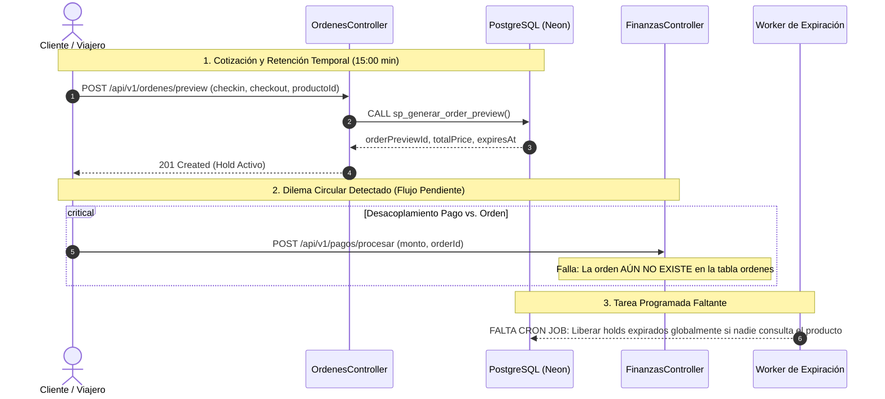

# Auditoría Técnica de Arquitectura Backend, Modelo de Datos y Hoja de Ruta MVP — Hábitat EC

---

## 1. Entidades Principales y Relaciones (TypeORM & PostgreSQL)

### 1.1. Discrepancia Arquitectónica Detectada: Mapeo TypeORM vs. SQL Nativo
Durante la auditoría del código fuente en `backend/src/`, se identificó una decisión de diseño híbrida:
* **Entidad TypeORM Declarativa Única:** En todo el proyecto solo existe **una única entidad mapeada con decoradores TypeORM**: [`Alojamiento`](file:///d:/PersonalJames/UNIVERSIDAD/SEXTO_SEMESTRE/IntegracionDeSistemas/Proyecto/habitat-ec/backend/src/alojamientos/entities/alojamiento.entity.ts) (`backend/src/alojamientos/entities/alojamiento.entity.ts`).
* **Acceso por `DataSource` / SQL Directo:** Todas las demás tablas del sistema (`productos_habitacion`, `ordenes`, `usuarios`, `roles`, `calendario_inventario`, `transacciones_pago`, etc.) no poseen clases `@Entity()` de TypeORM. En su lugar, los módulos consumen la base de datos mediante:
  1. `this.dataSource.query(sql, params)` con consultas SQL parametrizadas directas.
  2. Invocaciones a procedimientos almacenados (`sp_generar_order_preview`, `sp_crear_orden_idempotente`, `sp_cancelar_orden_idempotente`).
  3. Manejo manual de transacciones con `this.dataSource.createQueryRunner()`.
* **Configuración del ORM:** En [`app.module.ts`](file:///d:/PersonalJames/UNIVERSIDAD/SEXTO_SEMESTRE/IntegracionDeSistemas/Proyecto/habitat-ec/backend/src/app.module.ts), TypeORM está configurado con `synchronize: false`, delegando el control de esquema exclusivamente a migraciones SQL y scripts DDL.

---

### 1.2. Atributos Clave y Esquema Relacional de las Tablas Principales

#### A. Alojamientos / Propiedades (`alojamientos`)
* **Tabla física:** `alojamientos`
* **Entidad TypeORM:** `Alojamiento` (`@Entity('alojamientos')`)
* **Atributos clave:**
  * `alojamiento_id` (`bigint`, PK autoincremental).
  * `propietario_id` (`uuid`, FK $\rightarrow$ `usuarios.usuario_id`). Identifica al anfitrión dueño del establecimiento.
  * `ciudad_id` (`int`, FK $\rightarrow$ `ciudades.ciudad_id`). Vincula con la ciudad y sus coordenadas WGS84 PostGIS.
  * `tipo_id` (`int`, FK $\rightarrow$ `tipos_alojamiento.tipo_id`). Clasificación oficial del alojamiento.
  * `marca_id` (`int`, FK $\rightarrow$ `marcas_hoteleras.marca_id`, nullable). Asociación a cadenas turísticas.
  * `titulo` (`varchar(150)`), `descripcion` (`text`), `direccion` (`varchar(255)`).
  * `latitud` / `longitud` (`numeric(10,6)`). Coordenadas geográficas WGS84.
  * `estado_operativo` (`varchar(30)`): `CHECK (estado_operativo IN ('BORRADOR', 'PUBLICADO', 'SUSPENDIDO', 'PAUSADO', 'INACTIVO', 'BAJA'))`.
  * `activo` (`boolean`, default `true`). Bandera booleana para Soft Delete rápido.
  * `moneda_base` (`char(3)`, default `'USD'`).
  * `calificacion_promedio` (`numeric(3,2)`, default `5.00`), `total_resenas` (`int`, default `0`). Recalculados por trigger al insertar en `resenas`.
  * `deleted_at` (`timestamptz`, nullable), `motivo_baja` (`text`, nullable).
* **Relaciones directas:**
  * $1:N$ con `productos_habitacion` (`alojamiento_id`).
  * $1:N$ con `alojamiento_fotos` (`alojamiento_id`).
  * $N:M$ (4FN) con `facilidades` a través de `alojamiento_facilidades`.
  * $N:M$ (4FN) con `reglas_convivencia` a través de `alojamiento_reglas`.
  * $N:M$ (5FN) con `canales_integracion` a través de `alojamiento_canales`.
  * $N:M$ (5FN) con `politicas_cancelacion` a través de `alojamiento_politicas`.
  * $1:N$ con `ordenes` (`alojamiento_id`).

#### B. Habitaciones / Unidades (`productos_habitacion` y `calendario_inventario`)
* **Tabla física:** `productos_habitacion`
* **Naturaleza en el sistema:** Representa los tipos de habitación o unidades comercializables del establecimiento. No se maneja a nivel de "camas individuales", sino como **unidades de habitación completa** con capacidad de huéspedes y stock físico asignado.
* **Atributos clave:**
  * `producto_id` (`varchar(60)`, PK alfanumérico compuesto o UUID).
  * `alojamiento_id` (`bigint`, FK $\rightarrow$ `alojamientos.alojamiento_id`).
  * `nombre_producto` (`varchar(120)`). Ej. *"Suite Deluxe Vista al Volcán"*, *"Cabaña Familiar"*.
  * `capacidad_adultos` (`smallint`), `capacidad_ninos` (`smallint`).
  * `cantidad_cuartos_inventario` (`smallint`). Cupo total físico disponible (ej. 5 habitaciones dobles idénticas).
  * `precio_base_noche` (`numeric(12,2)`). Tarifa base en USD.
  * `plan_id` (`int`, FK $\rightarrow$ `planes_alimenticios.plan_id`). Régimen de comidas (`RO`, `BB`, `HB`, `FB`, `AI`).
  * `activo` (`boolean`, default `true`).
* **Tabla de Inventario Diario:** `calendario_inventario`
  * `producto_id` (`varchar(60)`, FK $\rightarrow$ `productos_habitacion.producto_id`).
  * `fecha` (`date`).
  * `estado_dia` (`varchar(25)`): `'DISPONIBLE'`, `'AGOTADO'`, `'BLOQUEADO_ANFITRION'`, `'RESERVADO'`.
  * `tarifa_noche` (`numeric(12,2)`). Tarifa específica para esa noche.
  * `cuartos_totales` (`smallint`), `cuartos_disponibles` (`smallint`). Cupos numéricos disponibles día por día.
  * PK Compuesta: `(producto_id, fecha)`.

#### C. Reservas y Órdenes (`ordenes` y `order_previews_holds`)
* **Tabla física:** `ordenes`
* **Atributos clave:**
  * `order_id` (`uuid`, PK).
  * `locator` (`varchar(20)`, UNIQUE). Localizador PNR amigable con formato `HAB-EC-XXXXXX`.
  * `alojamiento_id` (`bigint`, FK $\rightarrow$ `alojamientos.alojamiento_id`).
  * `producto_id` (`varchar(60)`, FK $\rightarrow$ `productos_habitacion.producto_id`).
  * `owner_id` (`uuid`, FK $\rightarrow$ `usuarios.usuario_id`). Huésped titular de la reserva.
  * `checkin` (`date`), `checkout` (`date`).
  * `noches` (`smallint`).
  * `number_of_adults` (`smallint`), `number_of_rooms` (`smallint`).
  * `total_price` (`numeric(12,2)`), `currency` (`char(3)`, `'USD'`).
  * `status` (`varchar(25)`): `'CONFIRMED'`, `'CANCELLED'`, `'COMPLETED'`.
  * `canal_id` (`int`, FK $\rightarrow$ `canales_integracion.canal_id`).
  * `politica_id` (`int`, FK $\rightarrow$ `politicas_cancelacion.politica_id`).
  * `payment_reference` (`varchar(100)`).
  * `idempotency_key` (`uuid`, UNIQUE).
* **Tabla de Bloqueo Temporal (Hold):** `order_previews_holds`
  * `order_preview_id` (`uuid`, PK).
  * `producto_id` (`varchar(60)`), `alojamiento_id` (`bigint`), `usuario_id` (`uuid`, nullable).
  * `checkin` (`date`), `checkout` (`date`).
  * `num_cuartos` (`smallint`), `num_adultos` (`smallint`).
  * `precio_total_cotizado` (`numeric(12,2)`).
  * `estado_preview` (`varchar(20)`): `'ACTIVO'`, `'EXPIRADO'`, `'CONVERTIDO_EN_ORDEN'`.
  * `expira_en` (`timestamptz`). Timestamp estricto de 15 minutos desde su emisión.

#### D. Usuarios y Roles (Lógica SUPERADMIN vs. Anfitriones)
* **Tablas físicas:** `usuarios`, `roles`, `usuario_roles`.
* **Atributos de `usuarios`:**
  * `usuario_id` (`uuid`, PK).
  * `nombre` (`varchar(100)`), `apellido` (`varchar(100)`).
  * `correo` (`varchar(150)`, UNIQUE).
  * `password_hash` (`varchar(255)`). Hasheado con bcrypt (factor de costo 10).
  * `telefono` (`varchar(25)`, nullable).
  * `cedula_ruc` (`varchar(20)`, nullable). Documento legal exigido en el aprovisionamiento de anfitriones.
  * `activo` (`boolean`, default `true`).
  * `creado_en` (`timestamptz`).
* **Lógica de Roles y RBAC:**
  * En la tabla `roles` existen los códigos canónicos:
    * `#1 - SUPERADMIN`: Administrador supremo. No es dueño directo de propiedades; gestiona catálogos maestros (`ciudades`, `tipos_alojamiento`, `cadenas`, `matriz 5FN`), aprovisiona anfitriones, audita `auditoria_forense` y ejecuta el worker de `outbox_events`.
    * `#2 - ADMIN`: Anfitrión / Operador turístico. Tiene alcance `TENANT_ALL` o restringido a sus establecimientos. Solo puede editar o dar de baja alojamientos donde `alojamientos.propietario_id == usuario.usuario_id`.
    * `#3 - CLIENTE`: Viajero que realiza reservas en el marketplace y publica reseñas.
  * La asignación es muchos a muchos mediante `usuario_roles(usuario_id, rol_id)`.
  * En el backend NestJS, la autorización se valida con `@UseGuards(JwtAuthGuard, RolesGuard)` y el decorador `@Roles('SUPERADMIN', 'ADMIN')`.

---

## 2. Gestión de Tipos de Alojamiento (Clasificación de Propiedades)

### 2.1. Diagnóstico de Implementación Actual
* **¿Se utiliza un Enum en TypeScript?** **NO.** En el backend no existe ningún Enum TypeScript para los tipos de alojamiento (a diferencia de `EstadoOperativoEnum` que sí existe para los estados operativos del alojamiento).
* **¿Es una tabla sembrada (Seed)?** **SÍ.** Existe la tabla relacional física `tipos_alojamiento` con las columnas `(tipo_id, codigo, nombre)`. En la base de datos se sembraron inicialmente los tipos base:
  1. `ECO_LODGE` $\rightarrow$ *"Eco-Lodge Sostenible"*
  2. `CABANA_MONTANA` $\rightarrow$ *"Cabaña de Montaña"*
  3. `HOTEL_BOUTIQUE` $\rightarrow$ *"Hotel Boutique Patrimonial"*
* **¿Se intentó hacer dinámico (CRUD de categorías)?** **SÍ.**
  * En [`catalogos.controller.ts`](file:///d:/PersonalJames/UNIVERSIDAD/SEXTO_SEMESTRE/IntegracionDeSistemas/Proyecto/habitat-ec/backend/src/catalogos/catalogos.controller.ts) existe el endpoint administrativo:
    * `POST /api/v1/catalogos/tipos-alojamiento` protegido con `@Roles('SUPERADMIN')`.
  * En [`catalogos.service.ts`](file:///d:/PersonalJames/UNIVERSIDAD/SEXTO_SEMESTRE/IntegracionDeSistemas/Proyecto/habitat-ec/backend/src/catalogos/catalogos.service.ts) el método `crearTipoAlojamiento(dto: CrearTipoAlojamientoDto)` ejecuta:
    ```sql
    INSERT INTO tipos_alojamiento (codigo, nombre)
    VALUES ($1, $2)
    RETURNING tipo_id, codigo, nombre;
    ```
  * Mediante esta capacidad dinámica, se agregaron posteriormente 4 tipologías adicionales:
    4. `GLAMPING_DOMO` $\rightarrow$ *"Glamping Domo Geodésico"*
    5. `HOSTERIA_CAMPESTRE` $\rightarrow$ *"Hostería Campestre & Agroturismo"*
    6. `HOSTAL_COMUNITARIO` $\rightarrow$ *"Hostal Eco-Comunitario"*
    7. `RESORT_AMAZONICO` $\rightarrow$ *"Eco-Resort de Selva Tropical"*
* **Vinculación con Alojamientos:**
  * En `alojamientos`, el campo es `tipo_id INT REFERENCES tipos_alojamiento(tipo_id)`.
  * El Wizard del anfitrión y el buscador del marketplace consultan `GET /api/v1/catalogos/tipos-alojamiento` para poblar dinámicamente los selectores.

---

## 3. Lógica de Reservas y Precios

### 3.1. Unidad de Cobro y Cálculo del Precio Total
* **¿Por habitación, por cama o por propiedad?**
  * El sistema calcula y cobra **POR HABITACIÓN (Room Unit) Y POR NOCHE**.
  * **No cobra por cama.** Las camas no están modeladas como entidades individuales.
  * **No cobra por propiedad completa por defecto**, salvo que el alojamiento sea una cabaña o lodge exclusivo configurado con un único producto habitación (`cantidad_cuartos_inventario = 1`).
* **Fórmula de Cálculo (Implementada en `sp_generar_order_preview`):**
  1. Se verifica la capacidad de huéspedes de la habitación:
     $$\text{p\_num\_adultos} \le (\text{ph.capacidad\_adultos} \times \text{p\_num\_cuartos})$$
     Si se excede, el stored procedure arroja la excepción `VALIDATION_FAILED` (`P0002`).
  2. Se suman las tarifas nocturnas registradas en `calendario_inventario`:
     $$\text{v\_subtotal} = \sum_{\text{fecha} = \text{checkin}}^{\text{checkout} - 1} \text{ci.tarifa\_noche}$$
  3. Se multiplica por la cantidad de cuartos solicitados y se aplica un factor del **11.5%** por concepto de cargos por servicio e impuestos locales:
     $$\text{v\_total} = \text{ROUND}\big((\text{v\_subtotal} \times \text{p\_num\_cuartos}) \times 1.115, \; 2\big)$$
  4. La moneda oficial es fijada en `'USD'`.

### 3.2. Validación y Bloqueo de Disponibilidad de Fechas
1. **Generación del Rango de Fechas:** Si las fechas solicitadas aún no existen en `calendario_inventario`, el procedimiento ejecuta un `generate_series(p_checkin, p_checkout - INTERVAL '1 day', '1 day')` para inicializarlas en estado `'DISPONIBLE'`.
2. **Purga Automática de Holds Expirados del Mismo Producto:** Antes de validar disponibilidad, el stored procedure ejecuta un CTE (`WITH holds_expirados AS ...`) que marca como `'EXPIRADO'` cualquier hold que haya superado los 15 minutos (`expira_en < NOW()`) y repone inmediatamente los cuartos disponibles:
   $$\text{cuartos\_disponibles} = \text{LEAST}(\text{cuartos\_totales}, \; \text{cuartos\_disponibles} + \text{he.num\_cuartos})$$
3. **Bloqueo Pesimista Atómico (`NOWAIT`):**
   * Se ejecuta una consulta bloqueante a nivel de fila sobre `calendario_inventario`:
     ```sql
     SELECT ci.fecha, ci.tarifa_noche
     FROM calendario_inventario ci
     WHERE ci.producto_id = p_producto_id
       AND ci.fecha >= p_checkin AND ci.fecha < p_checkout
       AND ci.cuartos_disponibles >= p_num_cuartos
       AND ci.estado_dia <> 'BLOQUEADO_ANFITRION'
     FOR UPDATE NOWAIT;
     ```
   * Si otra transacción ya tiene el bloqueo o alguna de las fechas no tiene stock suficiente (`cuartos_disponibles < p_num_cuartos`), PostgreSQL arroja un error inmediato y el procedimiento aborta con `ROOM_NO_LONGER_AVAILABLE` (`23P01`).
4. **Descuento de Stock en Calendario:**
   * Al crearse el hold de 15 minutos en `order_previews_holds`, se decrementa `cuartos_disponibles = cuartos_disponibles - p_num_cuartos`.
   * Si los cupos llegan a 0, `estado_dia` pasa automáticamente a `'AGOTADO'`.

---

## 4. Auditoría de Flujos Pendientes y Funciones Redundantes

### 4.1. Funciones y Endpoints Redundantes a Depurar
1. **Duplicidad de Búsqueda en `AlojamientosService`:**
   * Existen dos métodos con propósitos casi idénticos:
     * `findAll()`: Utiliza TypeORM QueryBuilder filtrando por `activo = true` y `estado_operativo = PUBLICADO`.
     * `findAllPublicos()`: Utiliza SQL directo sobre `alojamientos`, `productos_habitacion`, `ciudades` y `tipos_alojamiento` agrupando precios mínimos y fotos de portada.
   * *Acción recomendada:* Eliminar `findAll()` y mantener exclusivamente `findAllPublicos()` para evitar inconsistencias en el frontend.
2. **Rutas Alias Redundantes en `AuthController`:**
   * `@Post(['auth/registro-cliente', 'auth/register'])`: Define dos rutas para la misma acción. Debe estandarizarse en `POST /auth/registro-cliente` según el contrato OpenAPI.
3. **Limpieza Ad-hoc de Reglas en `onModuleInit()`:**
   * En [`catalogos.service.ts`](file:///d:/PersonalJames/UNIVERSIDAD/SEXTO_SEMESTRE/IntegracionDeSistemas/Proyecto/habitat-ec/backend/src/catalogos/catalogos.service.ts), `depurarReglasRedundantes()` ejecuta un bloque PL/pgSQL complejo en cada arranque del servidor para fusionar reglas de silencio y plástico.
   * *Acción recomendada:* Esta lógica debe residir en una migración SQL definitiva y removerse del ciclo de vida del servicio en NestJS para reducir el tiempo de arranque en frío en Azure.

---

### 4.2. Conexiones y Módulos Clave Pendientes para el Flujo de Reserva Completo



#### Faltante 1: Resolución del Desacoplamiento Circular entre Pagos y Órdenes
* **Problema técnico detectado:**
  * En `ordenes.service.ts`, `crearOrdenIdempotente` exige un campo `paymentReference: string`, asumiendo que el pago ya ocurrió.
  * Sin embargo, en `finanzas-resenas.service.ts`, el endpoint `POST /pagos/procesar` ejecuta:
    ```sql
    SELECT o.order_id, o.locator, o.total_price ... FROM ordenes o WHERE o.order_id = $1;
    ```
    lo que exige que la orden **ya exista previamente en la tabla `ordenes`** para poder asentar el cobro y crear la liquidación al anfitrión.
* **Solución requerida para el MVP:**
  * Unificar la transición: Permitir que `POST /ordenes/create` reciba el `orderPreviewId`, cree la orden en estado `'PENDING_PAYMENT'`, y de inmediato procese el pago atómicamente, o permitir que `POST /pagos/procesar` reciba el `orderPreviewId`, verifique el cobro y dispare la creación de la orden dentro de una misma transacción (`QueryRunner`).

#### Faltante 2: Worker / Cron de Expiración Automática de Holds
* **Problema técnico detectado:**
  * La liberación de stock de un hold vencido (`expira_en < NOW()`) actualmente solo se gatilla de forma reactiva si otro usuario cotiza exactamente el mismo producto habitación en `sp_generar_order_preview`.
  * Si ningún usuario vuelve a consultar esa habitación, las fechas quedan retenidas con `cuartos_disponibles` disminuido, bloqueando artificialmente el marketplace.
* **Solución requerida para el MVP:**
  * Instalar `@nestjs/schedule` y configurar un cron job cada 2 minutos en `OrdenesModule` que ejecute:
    ```sql
    WITH holds_expirados AS (
      UPDATE order_previews_holds
      SET estado_preview = 'EXPIRADO'
      WHERE expira_en < NOW() AND estado_preview = 'ACTIVO'
      RETURNING producto_id, checkin, checkout, num_cuartos
    )
    UPDATE calendario_inventario ci
    SET cuartos_disponibles = LEAST(ci.cuartos_totales, ci.cuartos_disponibles + he.num_cuartos),
        estado_dia = 'DISPONIBLE'
    FROM holds_expirados he
    WHERE ci.producto_id = he.producto_id
      AND ci.fecha >= he.checkin AND ci.fecha < he.checkout;
    ```

#### Faltante 3: Validación Temporal de Reseñas (Checkout Cumplido)
* **Problema técnico detectado:**
  * En [`finanzas-resenas.service.ts`](file:///d:/PersonalJames/UNIVERSIDAD/SEXTO_SEMESTRE/IntegracionDeSistemas/Proyecto/habitat-ec/backend/src/finanzas-resenas/finanzas-resenas.service.ts), `crearResena` valida que el usuario sea el dueño de la orden, pero no valida si `orden.checkout <= CURRENT_DATE`.
* **Solución requerida para el MVP:**
  * Añadir en la consulta de validación de la orden:
    ```typescript
    if (new Date(orden.checkout) > new Date()) {
      throw new BadRequestException('Solo puede calificar el alojamiento una vez completada su estadía (posterior al check-out).');
    }
    ```

#### Faltante 4: Webhook de Conciliación de Pasarelas de Pago
* **Problema técnico detectado:**
  * El adaptador [`PaymentGatewayAdapterService`](file:///d:/PersonalJames/UNIVERSIDAD/SEXTO_SEMESTRE/IntegracionDeSistemas/Proyecto/habitat-ec/backend/src/finanzas-resenas/payment-gateway.adapter.ts) prepara la URL de cobro para Payphone y Stripe (`Prepare`), pero no existe un endpoint `POST /api/v1/pagos/webhook` para recibir la notificación IPN / Webhook asíncrona oficial de la pasarela cuando el cliente paga desde su app móvil o tarjeta.
* **Solución requerida para el MVP:**
  * Implementar el endpoint público de webhook con validación de firma de Payphone para confirmar la transacción sin depender exclusivamente del navegador del cliente.

---

## 5. Pasos Finales Exactos para Terminar el MVP (Checklist de Ejecución)

| Paso | Acción Técnica | Componente Backend | Impacto |
| :---: | :--- | :--- | :--- |
| **1** | **Resolver ciclo de checkout y cobro:** Ajustar `POST /ordenes/create` para que admita token de pasarela o ejecute `procesarPago` en un único flujo atómico. | `ordenes.service.ts` / `finanzas-resenas.service.ts` | **Crítico:** Permite que un usuario reserve y pague de inicio a fin sin errores de clave foránea. |
| **2** | **Implementar Cron de liberación de holds:** Añadir `@Cron('*/2 * * * *')` para desocupar cupos retenidos de cotizaciones abandonadas. | `ordenes.service.ts` (`@nestjs/schedule`) | **Alto:** Evita falsos agotados en el inventario del marketplace. |
| **3** | **Depurar métodos redundantes:** Retirar `findAll()` en `AlojamientosService`, unificar rutas en `AuthController` y eliminar scripts DDL del arranque en `CatalogosService`. | `alojamientos.service.ts`, `auth.controller.ts`, `catalogos.service.ts` | **Medio:** Código limpio, mantenible y arranque en frío más veloz. |
| **4** | **Restricción de checkout en reseñas:** Exigir que la fecha de check-out haya expirado para registrar puntuaciones. | `finanzas-resenas.service.ts` | **Medio:** Integridad de reputación de alojamientos. |
| **5** | **Verificación del flujo E2E:** Ejecutar una prueba punta a punta desde la búsqueda en Marketplace $\rightarrow$ Hold 15 min $\rightarrow$ Pago $\rightarrow$ Confirmación PNR $\rightarrow$ Liquidación al anfitrión (85/15) $\rightarrow$ Evento Outbox. | Todos los módulos | **Crítico:** Cierre formal del MVP para el Reto 1 / Reto 2. |

