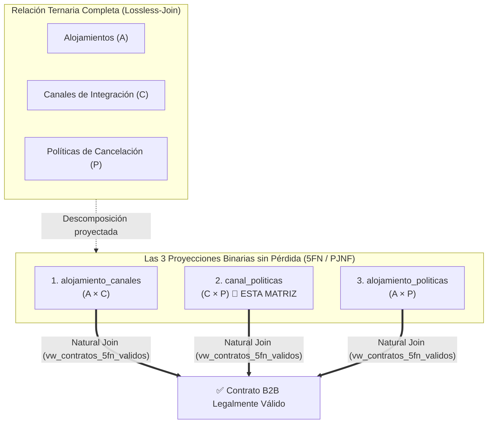

¡Entendido perfectamente! **No se ha modificado ni se modificará ningún archivo del proyecto**, para que puedas ingresar toda la información directamente interactuando con tu interfaz web.

A continuación, tienes los datos estructurados y listos para copiar y pegar en cada formulario de tu consola de **Superadmin**, junto con las explicaciones técnicas profundas sobre la **Matriz 5FN** y la **Pestaña 3** para tu defensa académica.

---

## 📋 Parte 1: Creación de 4 Cuentas ADMIN (Pestaña 1)

En la **Pestaña 1** (*Aprovisionar Nuevo Anfitrión*), ingresa estas 4 cuentas que representan anfitriones y operadores turísticos reales en distintas regiones clave de Ecuador:

| Campo Formulario | Cuenta 1 (Galápagos Eco-Lodge) | Cuenta 2 (Quito Patrimonial) | Cuenta 3 (Baños de Agua Santa) | Cuenta 4 (Cuenca & Cajas) |
| :--- | :--- | :--- | :--- | :--- |
| **Nombre** | `Mateo` | `Valeria` | `Santiago` | `Doménica` |
| **Apellido** | `Villalobos` | `Montenegro` | `Cárdenas` | `Pesántez` |
| **Correo Corporativo** | `anfitrion@galapagos-ecolodge.ec` | `gerencia@patrimonio-quito.ec` | `reservas@banos-adventure.ec` | `administracion@cajas-lodge.ec` |
| **Contraseña Inicial** | `AdminGalapagos2026!` | `AdminQuito2026!` | `AdminBanos2026!` | `AdminCuenca2026!` |
| **Cédula / RUC** | `2090012345001` | `1790087654001` | `1890043210001` | `0190065432001` |
| **Scope RBAC** | `TENANT_ALL` | `TENANT_ALL` | `TENANT_ALL` | `TENANT_ALL` |

> [!TIP]
> Al presionar **"Crear Cuenta ADMIN Verificada"**, la cuenta se creará con el rol `ADMIN` (código `#2`) en la tabla `usuario_roles` y aparecerá inmediatamente a la derecha en el *Directorio Global de Usuarios*.

---

## 🗺️ Parte 2: Llenado de Catálogos Maestros (Pestaña 2)

### 1. Catálogo de Ciudades PostGIS (Coordenadas Reales WGS84)
*(Mindo ya está registrada. Ingresa las principales capitales y destinos de alta demanda turística)*:

| Ciudad | Latitud | Longitud | Provincia / Región |
| :--- | :---: | :---: | :--- |
| `Quito` | `-0.180653` | `-78.467838` | Pichincha (Sierra Norte) |
| `Guayaquil` | `-2.189412` | `-79.889066` | Guayas (Costa) |
| `Cuenca` | `-2.900128` | `-79.005896` | Azuay (Sierra Sur) |
| `Baños de Agua Santa` | `-1.396389` | `-78.424722` | Tungurahua (Puerta a la Amazonía) |
| `Puerto Ayora` | `-0.743781` | `-90.313456` | Galápagos (Isla Santa Cruz) |
| `Otavalo` | `0.229167` | `-78.262500` | Imbabura (Geoparque Mundial) |
| `Tena` | `-0.993889` | `-77.812778` | Napo (Amazonía Alta) |
| `Montañita` | `-1.828889` | `-80.752222` | Santa Elena (Costa del Pacífico) |
| `Loja` | `-3.993130` | `-79.204224` | Loja (Sur Andino) |

---

### 2. Dominio de Tipos de Alojamiento (3 nuevos dominios)
*(Actualmente tienes `ECO_LODGE`, `CABANA_MONTANA` y `HOTEL_BOUTIQUE`)*:

| Código (Mayúsculas) | Nombre | Descripción del Dominio |
| :--- | :--- | :--- |
| `GLAMPING_DOMO` | `Glamping Domo Geodésico` | Domos de lujo inmersos en la naturaleza con bajo impacto ambiental. |
| `HOSTERIA_CAMPESTRE` | `Hostería Campestre & Agroturismo` | Establecimientos rurales con huertos, senderos y cabalgatas. |
| `HOSTAL_COMUNITARIO` | `Hostal Eco-Comunitario` | Hospedaje gestionado por comunidades locales indígenas o rurales. |
| `RESORT_AMAZONICO` | `Eco-Resort de Selva Tropical` | Complejos sostenibles con bungalows sobre pilotes y guías nativos. |

---

### 3. Facilidades y Sellos Verdes
*(Actualmente tienes Solar, Lluvia y Huerto)*:

#### A. Sellos Ecológicos y Sostenibilidad (**Marcar Checkbox: `es_sostenible = true`**)
* **Código:** `BIOCONSTRUCCION` • **Nombre:** `Bioconstrucción en Bambú y Adobe`
* **Código:** `BIODIGESTOR` • **Nombre:** `Tratamiento de Aguas Residuales con Biodigestor`
* **Código:** `CARBONO_NEUTRO` • **Nombre:** `Certificación Carbono Neutro Ecuador`
* **Código:** `CERO_PLASTICOS` • **Nombre:** `Política 100% Libre de Plásticos de un Solo Uso`
* **Código:** `GASTRONOMIA_KM0` • **Nombre:** `Gastronomía Orgánica Kilómetro Cero (Local)`

#### B. Facilidades de Confort y Servicios (**Desmarcar Checkbox: `es_sostenible = false`**)
* **Código:** `WIFI_STARLINK` • **Nombre:** `Internet Satelital Starlink de Alta Velocidad`
* **Código:** `SENDERISMO` • **Nombre:** `Senderos Privados para Avistamiento de Aves`
* **Código:** `ZONA_FOGATA` • **Nombre:** `Área de Fogata y Mirador Nocturno`
* **Código:** `PET_FRIENDLY` • **Nombre:** `Alojamiento Pet Friendly (Acepta Mascotas)`
* **Código:** `PISCINA_TERMAL` • **Nombre:** `Acceso a Piscinas de Agua Termal Mineralizada`

---

### 4. Cadenas Hoteleras y sus Reglas de Convivencia

Primero registra las **Cadenas Hoteleras** en el campo inferior y luego las **Reglas** en los campos superiores:

#### Cadena 1: `Mashpi Rainforest Collection`
* **Regla 1:**
  * **Código Regla:** `SILENCIO_BIOMA`
  * **Descripción:** `Silencio estricto de 21:00 a 06:00 para no perturbar la fauna silvestre de la reserva biológica.`
* **Regla 2:**
  * **Código Regla:** `NO_PLASTICOS_RESERVA`
  * **Descripción:** `Prohibido el ingreso de envases plásticos desechables en senderos y zonas de dosel.`

#### Cadena 2: `Oro Verde Hotels & Eco-Resorts`
* **Regla 1:**
  * **Código Regla:** `CHECKIN_DIGITAL_ID`
  * **Descripción:** `Check-in digital obligatorio presentando documento de identidad o pasaporte original.`
* **Regla 2:**
  * **Código Regla:** `DRESS_CODE_RESTAURANTE`
  * **Descripción:** `Código de vestimenta casual formal en áreas de restaurante gourmet y salones ejecutivos.`

#### Cadena 3: `Samari Spa & Mountain Lodges`
* **Regla 1:**
  * **Código Regla:** `ACCESO_CIRCUITO_TERMAL`
  * **Descripción:** `Acceso al circuito termal requiere reserva previa de turno y uso obligatorio de batas provistas.`
* **Regla 2:**
  * **Código Regla:** `PROHIBIDO_FUEGO_NO_AUTORIZADO`
  * **Descripción:** `Prohibido encender fogatas o fuentes de calor fuera de los braseros y chimeneas habilitadas.`

#### Cadena 4: `Decameron All Inclusive Ecuador`
* **Regla 1:**
  * **Código Regla:** `USO_BRAZALETE_ALL_INCLUSIVE`
  * **Descripción:** `Portar permanentemente el brazalete identificador en todas las áreas y puntos de consumo.`
* **Regla 2:**
  * **Código Regla:** `HORARIO_PISCINAS`
  * **Descripción:** `Uso de piscinas y toboganes exclusivamente de 08:00 a 20:00 por protocolo de salvavidas.`

---

## 🧩 Parte 3: ¿Cómo funciona la Matriz de Proyección en Quinta Forma Normal (`canal_politicas`)?

En tu imagen 3 tienes el panel **"5. Matriz de Proyección en Quinta Forma Normal (`canal_politicas`)"**.

### La explicación teórica y técnica para el docente:

1. **El Problema de la Dependencia de Unión (*Join Dependency*):**
   * En plataformas transaccionales tipo Booking, la relación entre un **Alojamiento**, un **Canal de Integración** (`WEB_REST`, `BOOKING_B2B`, etc.) y una **Política de Cancelación** (`FREE_CANCELLATION`, `NON_REFUNDABLE`, `MODERATE_50`) es una **relación ternaria cíclica**.
   * Si guardaras todo en una sola tabla `contratos(alojamiento_id, canal_id, politica_id)`, o si permitieras combinaciones arbitrarias, se producirían **tuplas espurias** (*spurious tuples* o falsas combinaciones) debido a anomalías de redundancia y actualización.

2. **La Quinta Forma Normal (5FN o *Project-Join Normal Form* - PJNF):**
   * Una tabla está en 5FN si y solo si cada dependencia de unión (JD) en ella es consecuencia lógica de sus claves candidatas.
   * La relación ternaria se descompone en **tres proyecciones binarias sin pérdida (*lossless-join*)**:
     1. `alojamiento_canales (alojamiento_id, canal_id)`: Qué canales tiene contratados el hotel.
     2. `alojamiento_politicas (alojamiento_id, politica_id)`: Qué políticas de cancelación ofrece el hotel.
     3. **`canal_politicas (canal_id, politica_id)`: La Matriz Maestra que tú configuras aquí.**

3. **¿Qué hace exactamente este selector en el frontend?**
   * Cuando seleccionas `#1 WEB_REST` y `#1 FREE_CANCELLATION` y pulsas **"Habilitar Par 5FN"**, estás dictaminando a nivel de plataforma que el protocolo web directo soporta cancelación gratuita.
   * Si intentas conectar el canal `#2 BOOKING_B2B` con una política que el contrato legal con Booking no permite (por ejemplo, una política no estándar), esa combinación simplemente **no existirá en `canal_politicas`**.
   * Por lo tanto, cuando el Anfitrión intente publicar su propiedad en el asistente de 4 pasos, la base de datos consulta la vista SQL:
     $$\text{vw\_contratos\_5fn\_validos} = \Pi_{A,C} \bowtie \Pi_{C,P} \bowtie \Pi_{A,P}$$
     Si el par no está habilitado en tu matriz, **la base de datos bloquea el contrato**, garantizando integridad semántica absoluta.

---

## 🔍 Parte 4: ¿Qué hace la Pestaña 3 (Auditoría Forense, Outbox y Webhooks)?

En tu imagen 4 tienes 3 módulos de infraestructura avanzada:

### 1. Suscripciones Webhook B2B (`POST /webhooks/subscribe`)
* **Propósito:** Permite registrar sistemas externos (como el **Booking Prototipo central** administrado por tus compañeros o un agregador de agencias) para que reciban notificaciones en tiempo real cuando algo cambie en Hábitat EC.
* **Campos del formulario:**
  * **URL del endpoint:** La URL HTTPS donde el partner escucha (ej. `https://booking-core-api.azurewebsites.net/api/v3/webhooks/habitat`).
  * **Secreto HMAC (mín. 16 caracteres):** Una clave secreta compartida (ej. `ClaveSecretaBooking2026_HMAC!`).
* **Cómo funciona:** Cuando ocurre un evento (`ORDER_CONFIRMED`, `STOCK_UPDATED`), Hábitat EC calcula una firma digital con **HMAC-SHA256** utilizando ese secreto y la envía en la cabecera `X-Signature-SHA256`. El receptor comprueba la firma para estar 100% seguro de que el mensaje es genuino y no fue interceptado ni alterado.

---

### 2. Bitácora de Auditoría Forense (`auditoria_forense`)
* **Propósito:** Cumplimiento legal, no repudio y trazabilidad profunda (*Audit Trail / CDC - Change Data Capture*).
* **Cómo funciona en el Backend:**
  * No depende de código en Node.js; opera mediante **triggers DML automáticos en PostgreSQL**.
  * Cada vez que un usuario realiza un `INSERT`, `UPDATE` o `DELETE` sobre tablas maestras o transaccionales (`ordenes`, `transacciones_pago`, `alojamientos`, etc.), el trigger de la base de datos se dispara en la misma micro-transacción y registra:
    * `nombre_tabla`: Tabla afectada.
    * `operacion`: Operación DML ejecutada (`INSERT`, `UPDATE`, `DELETE`).
    * `registro_id`: El ID del registro modificado.
    * `correlation_id`: El identificador único transversal (`X-Correlation-Id`) de la petición HTTP que causó el cambio, permitiendo rastrear qué llamada de API originó la mutación.
    * Fecha y hora inmutable del servidor.

---

### 3. Cola de Eventos (`outbox_events`) y Botón "Despachar Outbox (HMAC)"
* **Propósito:** Implementa el patrón arquitectónico empresarial **Transactional Outbox Pattern** (fundamental para el Reto 2 y arquitecturas EDA).
* **El Problema que Resuelve (Problema de la Doble Escritura / *Dual-Write*):**
  * Si un cliente paga una reserva, el sistema debe guardar la orden en PostgreSQL y notificar al Booking central.
  * Si el servidor guarda la orden y justo antes de llamar a la red se corta la luz o se cae la conexión, la orden queda cobrada pero el Booking nunca se entera (desincronización de stock).
* **La Solución Implementada en Hábitat EC:**
  * Cuando se confirma una orden o se actualiza una habitación, el evento se inserta en la misma transacción ACID dentro de la tabla `outbox_events` con `estado_despacho = 'PENDIENTE'`. Si la base de datos confirma la orden, el evento queda garantizado.
* **¿Qué hace el botón "Despachar Outbox (HMAC)"?**
  * Simula o invoca manualmente el **Worker Asíncrono** (`POST /api/v1/auditoria/outbox/despachar`).
  * El worker toma los eventos en estado `PENDIENTE`, recupera los webhooks suscritos para ese tipo de evento, genera la firma HMAC-SHA256 y marca el evento como `ENVIADO` con su marca de tiempo e incremento de intentos.
  * En la fase de integración (Reto 2), este despachador es el que alimenta la cola de **CloudAMQP (RabbitMQ)** hacia el Booking Prototipo.